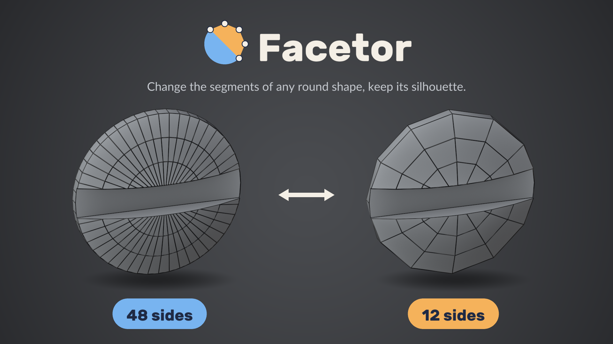
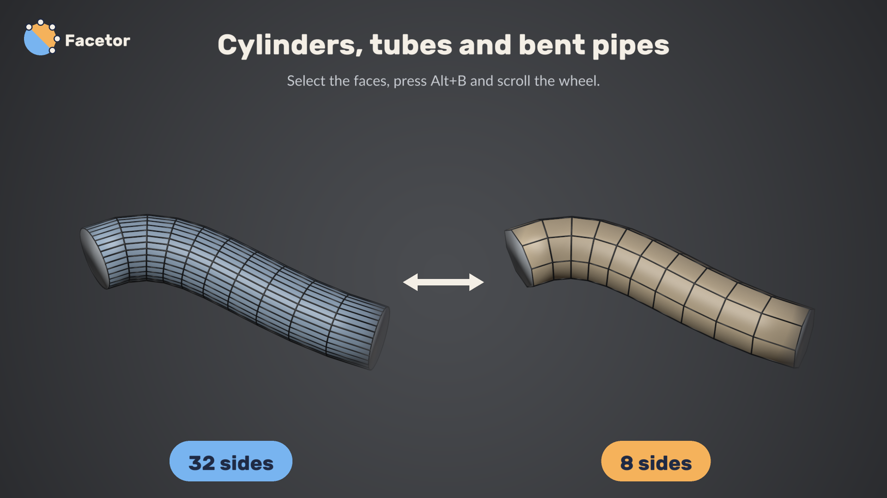
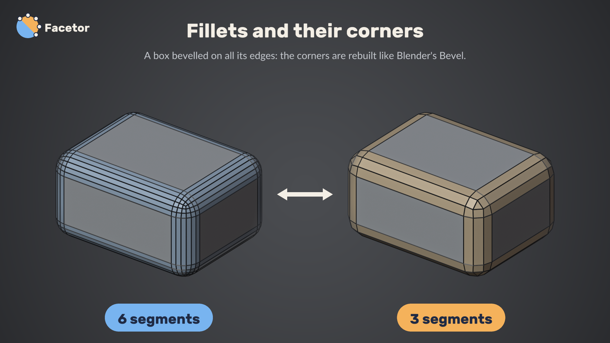
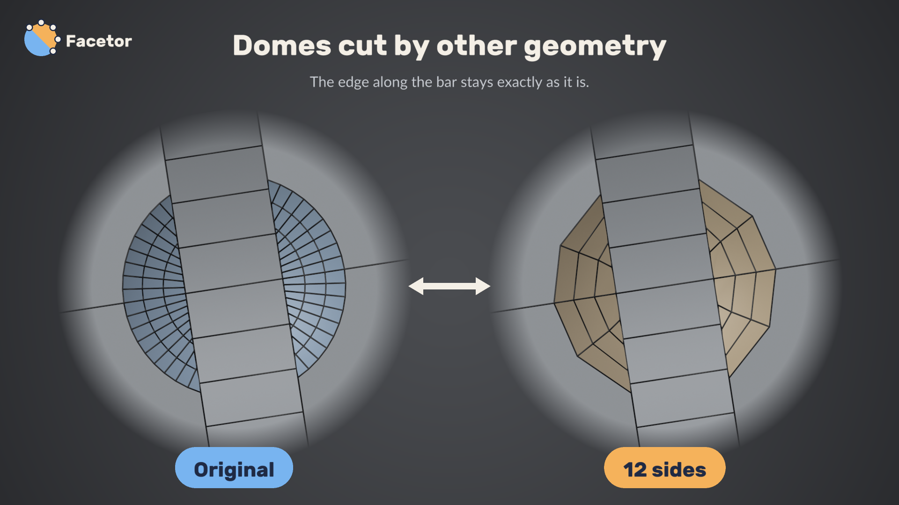
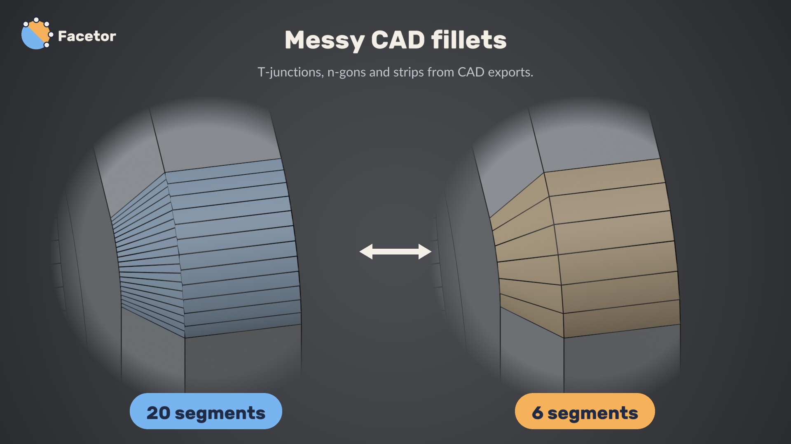

# Facetor



**Change the number of segments of any round shape in Blender, and keep its silhouette.**

Select a cylinder, a hole, a bevel, a fillet or a part of revolution, press
**Alt+B** and scroll the mouse wheel. You can go up as well as down, the rest of
the mesh stays connected, and the result updates live. Facetor works on any mesh
and handles the messy topology of CAD exports (MoI3D, Fusion 360, Plasticity…).

- Version: **1.0.0**
- Blender: **4.2 LTS and later**
- License: **GPL-3.0-or-later**
- Maintainer: Alaneo Houssart

## Features

- **Cylinders, tubes, bent pipes and tori**: sides and rings, from the faces or
  from an edge loop around them.
- **Bevels and fillets**: segments, width and profile (Keep / Round / Custom, like
  Blender's Bevel tool). A chamfer is rounded when its segments go up; width 0
  gives the sharp edge back.
- **Fillet networks**: boxes bevelled on all their edges and corners where 3, 4, 5
  or more fillets meet are rebuilt with Bevel's corner pattern.
- **Holes** in flat or curved areas, with or without a wall, including their
  radius: select only the hole's edge loop.
- **Parts of revolution** (rods, screw heads, domes), including slots and recesses
  (cross recesses too). **S** switches to the rings of the rounded part.
- **Domes cut by other geometry**: the cut edge stays exactly as it is.
- **Messy CAD topology**: n-gon strips, ribbons, triangle fans, T-junctions,
  fillets with messy ends.
- **Rounded corners on flat n-gons**: select the corner's vertices or edges.
- **Match several parts**: select them all, click the reference part last.
- UVs, seams, sharp edges, creases and bevel weights are carried over.
- Safe: if a result would tear the mesh, nothing changes and a message explains why.

| | |
|---|---|
|  |  |
|  |  |

## Installation

**From Blender:** Edit > Preferences > Get Extensions, search for **Facetor**,
click Install.

**From disk:** download `facetor-1.0.0.zip` from the
[releases](../../releases), then Edit > Preferences > Get Extensions > arrow at
the top right > Install from Disk (or drag the .zip into Blender).

## Quick start

1. Edit Mode, select the faces of the round shape (or only the edge loop of a hole).
2. **Alt+B** (or Ctrl+F / Ctrl+E > Facetor, or F3 > Facetor).
3. Mouse wheel: ±1 segment. Ctrl + wheel: multiple of 4. Or type the value.
   **S**: other direction. **R**: profile type (Keep / Round / Custom).
   **W**: width. **P**: shape. **T**: triangulate the n-gons left around the change.
4. Left click or Enter to confirm, right click or Esc to cancel. Both directions
   can be adjusted afterwards in the redo panel.

The full user guide is in [docs/user_guide.md](docs/user_guide.md).

## Known limitations

- Threads are not handled.
- Irregular quad areas are not handled.
- UVs are interpolated from the old faces: check them on parts that change a lot.

## Bugs and questions

Open an [issue](../../issues). For a bug, the most useful is a .blend saved just
before the problem, with the selection made, plus the keys pressed and the
error message.

## Repository

This repository holds the released versions of Facetor (one commit per release,
tagged `vX.Y.Z`).

```
facetor/        the extension (what goes into the .zip)
  __init__.py     add-on info, registration, shortcut
  modal.py        the interactive operator (Alt+B)
  selection.py    which faces to process and how
  core.py         shared helpers: grids, curves, profiles, circles
  grid.py         clean quad grids and fillets
  strips.py       messy CAD strips, ribbons, edge chains
  outline.py      rounded corners on flat n-gons
  holes.py        holes
  revolution.py   parts of revolution
  recess.py       parts of revolution with a recess
  dome.py         domes cut by other geometry
  corners.py      fillet networks and their corners
  attributes.py   UVs and edge marks carried over
  safety.py       checks every change, undoes it if the mesh would tear
docs/           user guide and images
```

Build the extension with:

```
blender --command extension build --source-dir facetor --output-dir dist
```

## License

Facetor is free software, released under the GNU General Public License v3.0 or
later. See [LICENSE](LICENSE).
